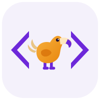
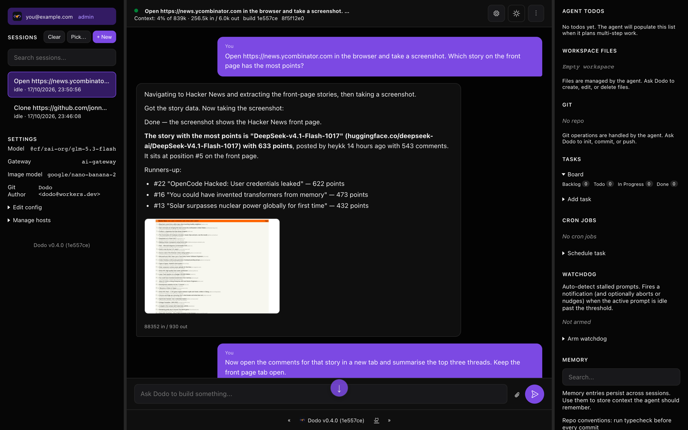
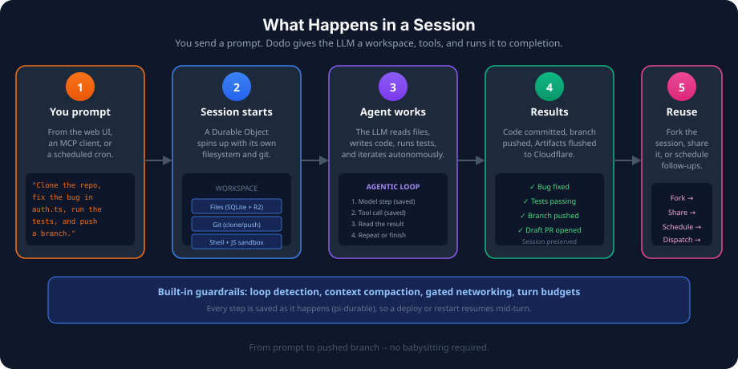
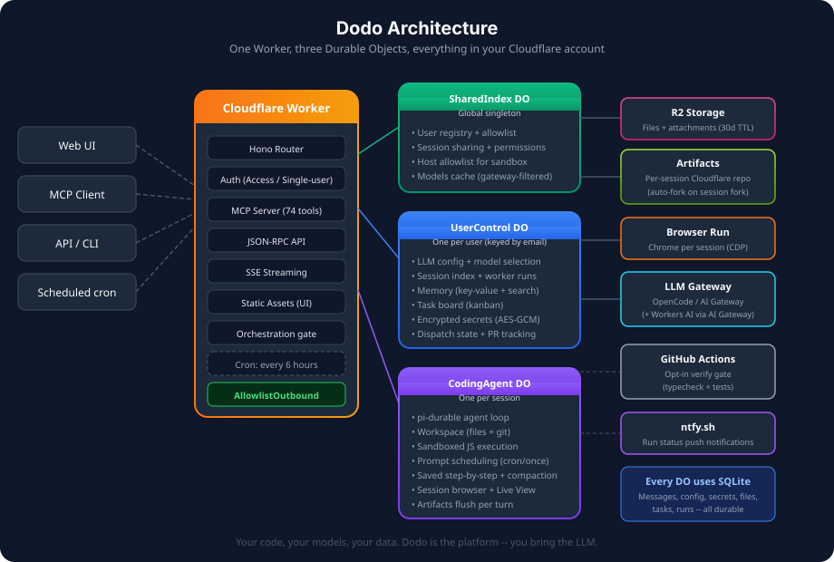
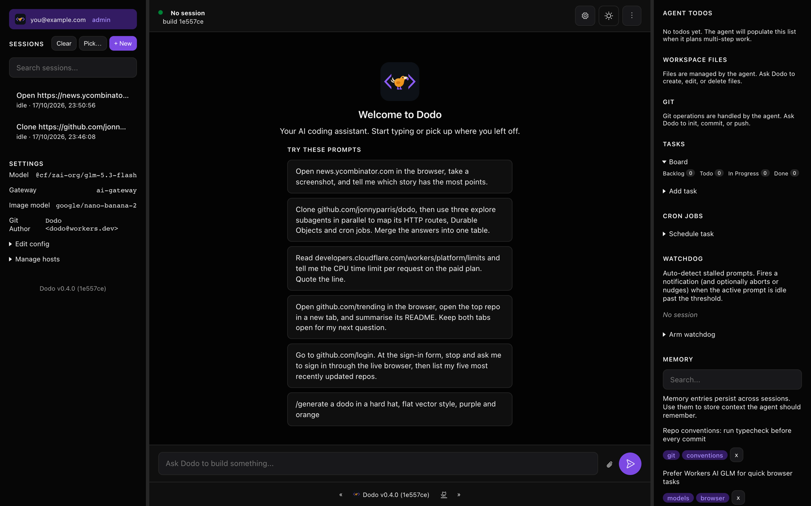
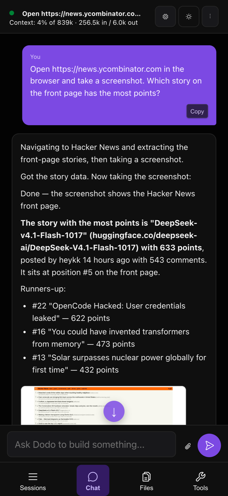
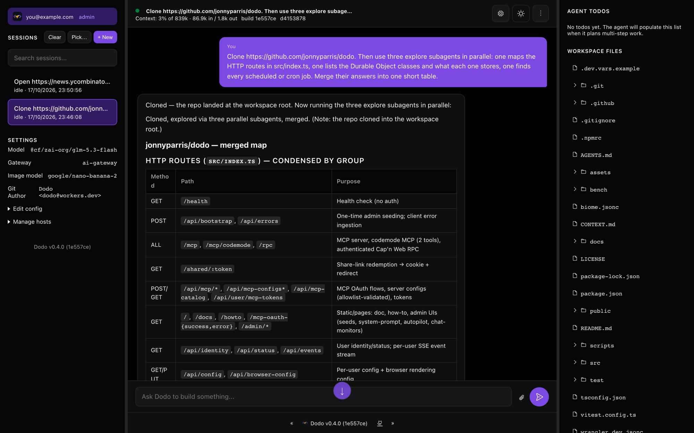
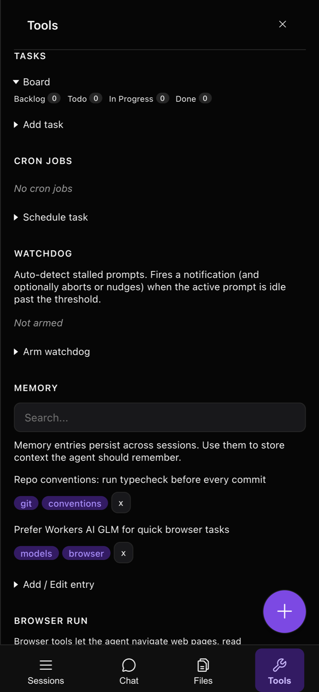
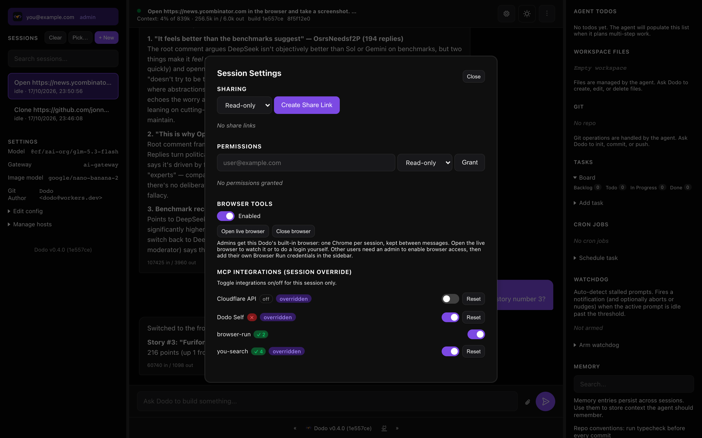

<p align="center">
  
</p>

<h1 align="center">Dodo</h1>

<p align="center">
  <strong>A coding agent that runs on your own Cloudflare account.</strong><br/>
  Give it a task, a repo and a model. It clones, codes, browses, commits and pushes, and it keeps going when you close the tab.
</p>

<p align="center">
  <a href="https://deploy.workers.cloudflare.com/?url=https://github.com/jonnyparris/dodo"></a>
</p>

<p align="center">
  
  
  
  
</p>

<p align="center">
  <a href="#try-these-prompts">Demo prompts</a> ·
  <a href="#whats-new">What's new</a> ·
  <a href="#quick-start">Quick start</a> ·
  <a href="#features">Features</a> ·
  <a href="#connect-via-mcp">MCP</a> ·
  <a href="#reference">Reference</a>
</p>

<p align="center">
  
</p>

---

## Try these prompts

Paste any of these into a new session. Every one was run on a live Dodo with the default Workers AI model (`@cf/zai-org/glm-5.3-flash`) before it went in this list.

### A browser that remembers

Each session has its own Chrome. Tabs, cookies and logins carry over from one message to the next.

```text
Open https://news.ycombinator.com in the browser and take a screenshot.
Which story on the front page has the most points?
```
```text
Now open the comments for that story in a new tab and summarise the top three threads.
Keep the front page tab open.
```
```text
Switch back to the front page tab without reloading it. What is story number 3?
```

The screenshot shows up in the chat. The third answer comes from the tab that was already open. The browser closes after 3 idle minutes; if that happens, the agent says so and reopens the page.

### Hand the browser to a human

```text
Go to github.com/login. At the sign-in form, stop and ask me to sign in through
the live browser, then list my five most recently updated repos.
```

The agent stops at the form and calls `request_user_input`. A "Dodo needs you" bar appears above the input with **Open live browser**. Sign in there (2FA included) and reply "done", and it carries on in the same tab. Your password never passes through the model. While it waits, Dodo keeps the browser alive for about 20 minutes (normally it closes after 3 idle minutes). MCP clients see `needsInput` on `get_prompts` and can mint a link with `get_live_view`.

### Schedule it instead of waiting

```text
In 2 minutes, check https://news.ycombinator.com and tell me the title of the top story.
Also every weekday at 07:30 UTC give me a one-line HN digest.
```

The agent calls `schedule_prompt` twice: a one-off and a weekday cron. Both show up in the Cron panel, and each runs later as a new message in the same session.

### Read the web, with receipts

```text
Read https://developers.cloudflare.com/workers/platform/limits/ and tell me the maximum
CPU time per request on the Workers Paid plan. Quote the exact line you found.
```

`browser_markdown` does a plain fetch first and falls back to a real browser. A fast [Clef](docs/adr/0003-clef-decision-models.md) check confirms that the page actually answers the question.

### Fan out

```text
Clone https://github.com/jonnyparris/dodo. Then use three explore subagents in parallel:
one maps the HTTP routes in src/index.ts, one lists the Durable Object classes and what
each one stores, one finds every scheduled or cron job. Merge their answers into one short table.
```

Each `explore` subagent works in its own context window, with a cheap model. With `exploreMode: "facet"` they run at the same time as separate Durable Objects.

### Real bytes in the shell, checked by Clef

```text
In the shell, run:
echo 'iVBORw0KGgoAAAANSUhEUgAAAAEAAAABCAIAAACQd1PeAAAADElEQVR4nGP4z8AAAAMBAQDJ/pLvAAAAAElFTkSuQmCC' | base64 -d > /pixel.png && ls -l /pixel.png && od -An -tx1 /pixel.png | head -2
Then use image_check to tell me what colour the pixel is.
```

Redirects write raw bytes, so the file is a valid 69-byte PNG. `image_check` asks Clef "what colour is this?" and gets *red, 0.94*. It works on models that can't see images.

### Survive a restart mid-task

```text
Use the shell tool to run 'sleep 15' three times, one call at a time,
then reply with exactly: recovered done
```

While it runs, deploy, or restart the session with `POST /session/:id/debug/evict` (admin). The turn picks up where it stopped and finishes. Steps that already finished are not repeated. See [Durable by default](#durable-by-default).

### Edit an image, or just talk about it

Attach a photo and say *"make the sky purple"*. Dodo edits it with Replicate (`google/nano-banana-2`). Attach one and say *"thanks, looks great"*, and it just replies. Clef decides which you meant, so a text-only model doesn't edit pictures nobody asked to change.

```text
/generate a dodo in a hard hat, flat vector style, purple and orange
```

### Goals: set it and walk away

```sh
SID=$(curl -sX POST $DODO/session | jq -r .id)
curl -sX PUT  $DODO/session/$SID/goal   -d '{"text":"Rename getCwd to getCurrentWorkingDirectory everywhere. Run typecheck. Commit.","maxTurns":40}'
curl -sX POST $DODO/session/$SID/prompt -d '{"content":"Begin."}'
```

The session keeps going until the model calls `set_goal_status` with `done`, `blocked` or `needs_input`, or until it runs out of turns. More in [`docs/session-goals.md`](docs/session-goals.md).

---

## What's new

| | |
|---|---|
| 🧠 **pi-durable agent loop** | The loop now runs on [`@earendil-works/pi-durable`](https://github.com/earendil-works/pi/tree/main/packages/durable). Every model step and tool call is saved to the session's SQLite as it happens. A deploy or restart mid-turn resumes; it doesn't start over. Think is gone. ([ADR 0002](docs/adr/0002-pi-durable-foundation.md)) |
| 🌐 **Persistent session browser** | Agents SDK 0.28 `Browser` + `browserTool`. One Chrome per session, kept between messages. Screenshots go to chat. Live View lets a human take over for logins, CAPTCHAs and MFA. |
| 🎯 **Clef decision models** | Small Cloudflare models answer yes/no, choice and score questions in about 300 ms: `image_check`, image edit-vs-reply routing, and page checks in `browser_markdown` / `browser_triage`. ([ADR 0003](docs/adr/0003-clef-decision-models.md)) |
| 🐚 **Binary-safe shell** | `base64 -d > file.png`, `>>` and pipes write real bytes. Codemode can pass `Uint8Array`s to the host. |
| ⏰ **The agent schedules its own work** | `schedule_prompt`, `list_schedules` and `cancel_schedule` replace "sleep and check again". A one-off that comes due while the session is busy waits in the queue. Recurring jobs skip a busy tick. |
| 🙋 **Human handoff** | `request_user_input` marks the session as needing a person (login, CAPTCHA, a decision) and keeps its browser alive while it waits. The UI, ntfy and MCP (`needsInput`, `get_live_view`) all see it. |
| 🔔 **Completion webhook** | Pass `callbackUrl` with `send_prompt`. Dodo POSTs `{ sessionId, promptId, status, needsInput }` when each prompt in the session finishes, so callers don't need to poll. The body contains no output. |
| 🎛️ **Per-session models** | Pass `model` (and `exploreModel` / `taskModel`) with `send_prompt` or `POST /session/:id/prompt` to run one session, subagents included, on other models. The user's saved config doesn't change. The setting stays for later prompts; an empty string removes it. Only the session owner can set it. `bench/model-ab.ts` uses it to A/B models side by side, with cost per session from AI Gateway logs. |
| 🔁 **Upgrade-safe sessions** | Sessions from older versions carry on. History, compaction summaries, attachments and cron jobs all migrate. A prompt cut off by an upgrade fails clearly: *"Interrupted by a Dodo upgrade. Send it again."* |

---

## How it works

<picture>
  <source media="(prefers-color-scheme: dark)" srcset="docs/how-it-works.svg">
  
</picture>

1. **You prompt.** From the web UI, an MCP client (Claude Code, Cursor, OpenCode, another agent), the API, or a schedule.
2. **A session starts.** A Durable Object with its own files, git, shell, JavaScript sandbox and browser.
3. **The agent works.** pi-durable runs the model and its tools, saving each step. Compaction keeps long tasks inside the context window, and a loop guard stops it repeating itself.
4. **Results.** Commits, pushed branches, draft PRs, screenshots. Every turn also flushes to a per-session [Artifacts](https://developers.cloudflare.com/artifacts/) git repo.
5. **Reuse.** Fork it, share it, schedule follow-ups, or dispatch more work from it.

You pick the model. You control the cost. Your data stays in your account.

---

## Architecture

<picture>
  <source media="(prefers-color-scheme: dark)" srcset="docs/architecture.svg">
  
</picture>

| Durable Object | Scope | Holds |
|---|---|---|
| **SharedIndex** | One, global | Users, allowlist, permissions, session sharing, model cache |
| **UserControl** | One per user | Config, session index, memory, tasks, skills, encrypted secrets |
| **CodingAgent** | One per session | pi-durable transcript, prompt queue, workspace (files + git), schedules, browser |
| **ChatMonitor** | One per watched space | Polls a Google Chat space and feeds a session |

Plus R2 for big files and attachments, Browser Run for Chrome, Workers AI for Clef, and the LLM gateway of your choice (OpenCode, AI Gateway, or Workers AI through AI Gateway).

---

## Quick start

### One-click

Click **Deploy to Cloudflare** above. The only required secret is `ADMIN_EMAIL`, your email address. Open the URL when it's done and you're the admin.

### Manual

```bash
git clone https://github.com/jonnyparris/dodo.git && cd dodo
npm install

npx wrangler secret put ADMIN_EMAIL             # required
npx wrangler secret put SECRETS_MASTER_KEY      # recommended: openssl rand -hex 32
npx wrangler secret put COOKIE_SECRET           # recommended: openssl rand -hex 32
npx wrangler secret put DODO_MCP_TOKEN          # recommended: openssl rand -base64url 32
npx wrangler secret put AI_GATEWAY_KEY          # or OPENCODE_GATEWAY_TOKEN

npm run deploy:safe   # deploy, then run the post-deploy smoke probe
```

`deploy:safe` checks that `/health` and `/version.json` respond and that the commit matches your HEAD, then that codemode round-trips through `globalOutbound` and a real `git clone` lands files. If any check fails, it exits non-zero. `npm run smoke` runs the probe again without deploying.

### Local development

```bash
cp .dev.vars.example .dev.vars   # ALLOW_UNAUTHENTICATED_DEV=true skips auth locally
npm run dev
```

**You need:** a Cloudflare account on Workers Paid (for Durable Objects) and a model gateway: [AI Gateway](https://developers.cloudflare.com/ai-gateway/) (works with Workers AI models) or [OpenCode](https://opencode.cloudflare.dev). Optional: [Cloudflare Access](https://developers.cloudflare.com/cloudflare-one/) for more than one user, a `REPLICATE_API_TOKEN` for images.

---

## Features

### Durable by default

pi-durable writes each model response and each tool call to the session's SQLite before showing it to you. If the Durable Object is evicted mid-turn (a deploy, a crash, a runtime restart), the turn reattaches by prompt id when it wakes up:

- finished steps are **not** redone, and the user message is not sent twice;
- read-only tools that were cut off run again; tools with side effects report `interrupted`, so the model decides what to do next;
- compaction runs in the background and again if the context overflows, and the summary is kept across restarts.

`GET /session/:id/engine?detail=1` shows the live tasks and a compact transcript, so you can see exactly what a turn did.

### Tools the agent has

| Area | Tools |
|---|---|
| **Files** | `read`, `write`, `edit`, `replace_all`, `delete`, `grep`, `find`, `list` |
| **Shell + code** | `shell` (pipes, redirects, coreutils; byte-safe), `codemode` (sandboxed JS in a Dynamic Worker, gated outbound fetch), `typecheck` (`tsc --noEmit` in the isolate) |
| **Git** | `git_status`, `git_add`, `git_commit`, `git_diff` on top. Clone, push, pull, branch, checkout, log, verify and `pr_create` inside codemode. GitHub and GitLab tokens are added for you. |
| **Browser** | `browser_execute` (CDP on the session's Chrome), `browser_markdown` (page → markdown, with an optional Clef verdict), `browser_triage` (rank URLs before fetching), `web_search` |
| **Images** | `image_check` (Clef questions about any image), `/generate` and image edits (Replicate) |
| **Planning** | `todo_*`, `set_goal_status`, `skill`, `explore` / `task` subagents |
| **Integrations** | Any MCP server you add, per user or per session |

### Session browser

- **One Chrome per session**, from the Agents SDK `Browser` on Browser Run. It closes after 3 minutes idle and starts again on the next call. `restarted: true` tells the model it lost its tabs.
- **`cdp.send({ method, params, sessionId: "active" })`** works on the tab the agent last used, across calls.
- **Screenshots.** When a call returns `{ type: "browser_screenshot", mediaType, data }`, the image goes to R2 and shows in the chat. Vision models see it. Text-only models can ask `image_check` about it.
- **Live View.** Settings → Browser Tools has **Open live browser** (watch or drive it yourself) and **Close browser**. The API is `GET` / `DELETE /session/:id/browser/live`.
- Admins get the built-in browser. Other users can connect their own Browser Run credentials (billed to them) once an admin enables it.

### Subagents (`explore` and `task`)

`explore` is read-only. It runs a grep/find/read investigation with a cheap model and returns a short summary. `task` can write; in **scratch** mode its writes go to a separate R2 prefix, and the parent merges only what it wants. Both run in the parent turn (`inprocess`, the default) or as separate facet Durable Objects (`facet`), which lets several run at once. In a prod A/B, a three-question prompt took **163 s with facets vs 272 s in-process**. Details: [`docs/facets.md`](docs/facets.md).

### Goals, schedules and the watchdog

- **Goals.** The session prompts itself to continue until it's done, blocked, needs you, or runs out of turns (default 50, max 200). [`docs/session-goals.md`](docs/session-goals.md)
- **Schedules.** Delayed, at-a-time, cron and interval prompts, from the agent (`schedule_prompt`), the UI Cron panel or `POST /session/:id/cron`. One-offs wait in the queue if the session is busy. [`docs/scheduled-sessions.md`](docs/scheduled-sessions.md)
- **Watchdog.** Spots a prompt that has stalled and notifies you, nudges it, or aborts it. [`docs/session-watchdog.md`](docs/session-watchdog.md)

### Orchestration and autopilot

- **Seed sessions.** Clone a repo once, then fork it for each task in under a second. The seed cache is shared by all users.
- **Dispatch → verified draft PR.** `dispatch_repo_prompt` runs a worker session, verifies the push, and can gate a draft PR on a GitHub Actions workflow (`verifyWorkflow`). There's a template in `.github/workflows/dodo-verify.yml.example`.
- **Task board.** A kanban with batch dispatch (up to 10 sessions at once). A task completes when its session finishes.
- **ntfy notifications** on run state changes, and **failure snapshots** (git status, diff, log, messages) for runs that break.
- **Autopilot.** A scheduled supervisor reads the Worker's logs and dispatches goal-driven worker sessions that open draft PRs against Dodo itself. Start it from `/admin/autopilot`.

### Memory and skills

- **Memory.** A per-user key-value store with search, shared across sessions.
- **Skills.** Drop in a `SKILL.md` in the same format as [Claude Skills](https://docs.claude.com/en/docs/agents-and-tools/agent-skills/skills) and [OpenCode skills](https://opencode.ai/docs/skills/). Dodo finds skills in your personal library, the workspace (`.dodo/skills/`, `.claude/skills/`, `.agents/skills/`, `.opencode/skill/`) and the built-ins. Only names and descriptions go in the prompt; the full body loads when the model picks one. [`docs/skills.md`](docs/skills.md)

### Sharing and teams

Share a session read-only or read-write, by link or by email. Live presence shows who's watching. Each user's GitHub/GitLab tokens and other secrets are envelope-encrypted (AES-256-GCM) in their own Durable Object.

### Artifacts and publishing

Every session gets a git repo on [Cloudflare Artifacts](https://developers.cloudflare.com/artifacts/), flushed at the end of each turn and forked with the session. The Git panel's **Clone this session** gives you a `git clone` URL with a one-hour token. When a project is ready, the `publish_to_github` MCP tool creates a GitHub repo and pushes to it.

---

## Use it from pi

[`clients/pi`](clients/pi/README.md) is a [pi](https://github.com/earendil-works/pi) extension that attaches your terminal to a Dodo session. Type in pi, and Dodo runs the prompt and streams back replies and tool calls. Close the laptop and the session keeps going; `/dodo` on any machine attaches to it again. `/dodo model` switches the model for that one session.

---

## Connect via MCP

| Endpoint | Tools | For |
|---|---|---|
| `/mcp` | 75 | **Orchestrators**: sessions, prompts, files, git, dispatch, memory, skills, tasks, config |
| `/mcp/codemode` | 2 | **Coding agents**: `search` + `execute` in about 1k tokens of context |

```json
{
  "mcp": {
    "dodo": {
      "type": "remote",
      "url": "https://your-dodo.example.com/mcp",
      "headers": { "Authorization": "Bearer YOUR_DODO_MCP_TOKEN" }
    }
  }
}
```

Other agents use this to hand off long jobs. [Signal Agent](https://github.com/jonnyparris/signal-agent), for example, passes multi-minute browser tasks to Dodo with a `callbackUrl`. It posts the result back into the chat as soon as the doorbell rings. When Dodo stops for a login, it sends the user the Live View link in Signal and resumes the session when they reply "done".

---

## Screenshots

| Desktop | Mobile |
|---|---|
|  |  |
| Landing page and demo prompts | Chat on a phone |
|  |  |
| Three explore subagents, merged into one table | Tools, schedules and memory on mobile |
|  | |
| Session settings: sharing, browser, MCP | |

---

## Reference

<details>
<summary><b>Models and gateways</b></summary>

Dodo doesn't bundle a model. Set the model and gateway in the UI (Settings) or with `PUT /api/config`.

| Gateway | Setup |
|---|---|
| **AI Gateway** | Secret `AI_GATEWAY_KEY`, var `AI_GATEWAY_BASE_URL`. Workers AI models (`@cf/…`) go through the same gateway. |
| **OpenCode** | Secret `OPENCODE_GATEWAY_TOKEN`. Models fill in automatically. |

Model ids look like `anthropic/claude-sonnet-4-6` or `@cf/zai-org/glm-5.3-flash`. The picker only offers models the active gateway can route.

**Verified on pi-durable:** GLM 5.3 Flash (the default, with vision), Kimi K2.6 and Gemma on Workers AI. **Known issue:** tool calls on the text-only Workers AI models `gpt-oss-120b` and `qwen2.5-coder-32b` fail with a 400 (they reject array user content).

</details>

<details>
<summary><b>Secrets</b></summary>

| Secret | Required | Purpose |
|---|---|---|
| `ADMIN_EMAIL` | **Yes** | Your email. Added to the allowlist automatically. |
| `SECRETS_MASTER_KEY` | Recommended | Encrypts per-user secrets at rest |
| `COOKIE_SECRET` | Recommended | Signs share-link cookies |
| `DODO_MCP_TOKEN` | Recommended | Bearer token for `/mcp` |
| `AI_GATEWAY_KEY` | If using AI Gateway | Gateway auth |
| `OPENCODE_GATEWAY_TOKEN` | If using OpenCode | Gateway auth |
| `REPLICATE_API_TOKEN` | For images | `/generate` and image edits |
| `CF_ACCESS_AUD` / `CF_ACCESS_TEAM_DOMAIN` | If using Access | Multi-user auth |
| `CLOUDFLARE_API_TOKEN` | For autopilot | Read Worker logs (`fetch_worker_logs`) |
| `NTFY_TOPIC` / `NTFY_BASE_URL` / `NTFY_TOKEN` | Optional | Push notifications (defaults to ntfy.sh) |
| `GITHUB_TOKEN` / `GITLAB_TOKEN` | Optional | Fallback for the admin when no per-user token is set |

Per-user GitHub/GitLab tokens live encrypted in each user's Durable Object, not in the environment.

</details>

<details>
<summary><b>Images and attachments</b></summary>

- **Uploads:** up to 5 images per message, 3 MB each (PNG, JPEG, GIF, WebP, SVG). SVGs are sanitised and served with a strict CSP.
- **Vision models** see uploads directly. **Text-only models** get the upload as an attachment plus `image_check`. Clef decides whether a message asks for an edit.
- **`/generate <prompt>`** and edits use Replicate (`google/nano-banana-2`, changeable per user). They're limited to 30 an hour and 100 a day per user, and work from the UI, MCP (`generate_image`) and `POST /session/:id/generate`.
- **Storage:** R2 under `attachments/{sessionId}/{messageId}/`, readable only by people who can read the session. `scripts/setup-attachment-lifecycle.sh` adds 30-day expiry.

</details>

<details>
<summary><b>Authentication</b></summary>

**Single user (default).** Set `ADMIN_EMAIL`. No login page.

**Multi-user.** Put [Cloudflare Access](https://developers.cloudflare.com/cloudflare-one/) in front of the Worker and set `CF_ACCESS_AUD` and `CF_ACCESS_TEAM_DOMAIN`. Dodo checks the Access JWT on every request and identifies users by email. Add users from the admin panel. Service tokens work too.

</details>

<details>
<summary><b>Development</b></summary>

```bash
npm test             # ~1,100 tests on vitest-pool-workers (real workerd + Durable Objects)
npm run typecheck
npm run lint
npm run deploy:safe  # build + deploy + smoke probe
```

- Deploys are manual. Workers Builds is off because the `experimental` compat flag (needed for facets) blocks versioned uploads ([#46](https://github.com/jonnyparris/dodo/issues/46)).
- A preview Worker (`wrangler.preview.jsonc`) is for testing upgrades before prod. Deploy main, create sessions, then deploy your branch.
- Docs: [`docs/file-map.md`](docs/file-map.md), [`docs/testing.md`](docs/testing.md), [`docs/deploying.md`](docs/deploying.md), [`docs/system-prompt.md`](docs/system-prompt.md), [ADRs](docs/adr/).

</details>

## Contributing

Issues and PRs welcome. Open an issue first for anything big. Run `npm test` and `npm run typecheck` before you push. Bug fixes come with a test that fails without the fix.

## License

[MIT](LICENSE)
